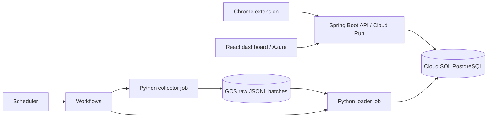

# SmartCart

Explainable cross-retailer product matching. SmartCart identifies product variants using manufacturer identifiers and category-specific specifications, then explains **Exact**, **Equivalent**, **Near-equivalent**, **Different**, or **Insufficient evidence** results.

**Stack:** Chrome extension · React · Java 21/Spring Boot · Python 3.12 · PostgreSQL 16 · Google Cloud Run/Cloud SQL/Storage · Azure Static Web Apps · Terraform · GitHub Actions.

## System



| Directory | Purpose |
|---|---|
| `frontend/extension`, `frontend/dashboard` | Browser UI and optional dashboard |
| `backend/smartcart-api` | Spring Boot REST API, matching rules and tests (see active backend branch) |
| `data/ingestion` | Python collection, raw-batch validation, normalization, SQL and tests |
| `cloud/terraform/dev` | GCP resources; deployment managed via GitHub Actions |
| `cloud/bootstrap`, `cloud/workflows` | One-time cloud bootstrap and batch orchestration |
| `.github/workflows` | Automated tests and controlled image/infrastructure deployments |
| `docs/architecture.md`, `docs/data-contract.md` | Architecture decisions and backend data contract |

## Local development

**Ingestion (no cloud account or database required for dry runs):**

```bash
python3 -m venv .venv
source .venv/bin/activate
python -m pip install -r data/ingestion/requirements.txt
cd data/ingestion
python -m unittest discover -s tests -v
python -m collector.main --source fixtures --run-id local-001 --output-dir /tmp/smartcart
python -m loader.main --manifest-uri /tmp/smartcart/manifests/local-001.json --dry-run
```

For a larger synthetic run, use `--max-records 500` and a fresh `--run-id`. The default is 25. `data/ingestion/config.yaml` defines local defaults; environment variables and CLI flags override appropriate settings in cloud/jobs. Synthetic retailer domains end in `.example` and are **not actual listings**.

**Database:** `compose.yaml` starts PostgreSQL 16; provide a local `.env` based on `.env.example`. Set `DB_HOST`, `DB_NAME`, `DB_USER` and `DB_PASSWORD`, then omit `--dry-run` to load a batch. Repeating a run is idempotent. Keep passwords out of Git.

**Backend:** the Spring Boot project lives in `backend/smartcart-api` on `feature/aayush-backend`; once merged, build/test using `mvn -f backend/smartcart-api/pom.xml test`. Current candidate retrieval is not yet connected to the catalog. The extension is still under development.

## Sources and scope

- **Fixtures:** 25 listings from five *fictional* retailers for repeatable tests; 500 through configuration for scale/replay tests.
- **Best Buy:** one optional real Products API adapter; requires authorized API access and `BESTBUY_API_KEY` (provided via GCP Secret Manager in deployed jobs). Actual returned count and usable variant specs depend on the API.
- **Additional retailers:** separate authorized adapters are required before claiming five-retailer live coverage. Do not bypass website access controls.

See [architecture and trade-offs](docs/architecture.md) and [database/API contract](docs/data-contract.md). CI tests are a prerequisite to merging; successful code validation does not by itself prove a cloud deployment is live.
