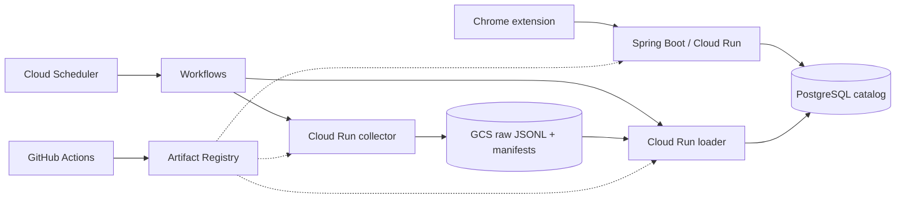

# SmartCart

SmartCart is an explainable cross-retailer product comparison system. It distinguishes identical manufacturer variants from similar models and compares retailer offers with provenance and freshness information.

**Initial categories:** televisions and dishwashers. **Deployment:** Google Cloud Run, Cloud SQL for PostgreSQL 16, Cloud Storage, Workflows and Secret Manager. **Clients:** Chrome extension and optional React dashboard. **Matching API:** Java 21 / Spring Boot. **Ingestion:** Python 3.12.

## Architecture



The collector reads product pages using a common HTTP/HTML engine and small retailer adapters. The loader validates manifests and source records, identifies canonical manufacturer models, and upserts retailer offers. It does not invent unavailable prices or force ambiguous matches.

## Repository guide

| Location | Responsibility |
|---|---|
| `data/ingestion/collector/scraping/` | HTTP, discovery, retailer URL adapters and JSON-LD/HTML extraction |
| `data/ingestion/config.yaml` | Retailer URLs, collection categories, discovery and HTTP limits |
| `data/ingestion/common/` | Source-neutral configuration and record validation |
| `data/ingestion/loader/`, `data/ingestion/sql/` | GCS/local manifest verification and PostgreSQL migrations |
| `backend/smartcart-api/` | Spring Boot API, matching and candidate retrieval (maintained separately) |
| `frontend/extension/` | Current-page identification and comparison interface |
| `cloud/terraform/dev/` | Version-controlled GCP resource configuration |
| `.github/workflows/` | Named CI, CD and operations workflows |
| `docs/` | Architecture, data contract, scraping and delivery runbooks |

## Local development

Python 3.12 and dependencies:

```bash
python3 -m venv .venv
source .venv/bin/activate
pip install -r data/ingestion/requirements.txt
cd data/ingestion
python -m unittest discover -s tests -v
```

Run the same real-product collector used in Cloud Run, with a small limit and local output:

```bash
python -m collector.main --source scrape --retailers abt,homedepot \
  --max-records 3 --output-dir /tmp/smartcart-raw
```

The collector prints a manifest URI on success. If all sites decline requests or product identification fails, it exits with an error rather than producing placeholder offers. Run an offline end-to-end validation without external HTTP calls using the maintained test support:

```bash
python -m tests.create_offline_batch --output-dir /tmp/smartcart-ci
python -m loader.main --manifest-uri /tmp/smartcart-ci/manifests/ci-offline-batch.json --dry-run
```

For local PostgreSQL, set `DB_HOST`, `DB_PORT`, `DB_NAME`, `DB_USER`, `DB_PASSWORD`, then omit `--dry-run`. Do not use the live Cloud SQL credentials on a laptop.

## Cloud delivery

- **CI:** Pull requests run repository, ingestion and Terraform checks as applicable.
- **Continuous deployment:** A merge into `main` affecting ingestion code triggers ingestion tests, publishes collector/loader images with immutable commit tags, then updates existing Cloud Run Jobs. Backend code merges similarly test, build and deploy the Spring Boot service.
- **Infrastructure:** Terraform apply remains manually approved and uses shared GCS state. Schema migrations run transactionally with the loader; database password remains in GCP Secret Manager.
- **Ingestion execution:** Cloud Workflows is separate from code deployment. Cloud Scheduler remains paused until data collection is validated.

See [CI/CD](docs/ci-cd.md), [scraping operations](docs/scraping.md), [data contract](docs/data-contract.md), and [deployment](docs/deployment-runbook.md).

## Current operational boundaries

Scraping supported product pages is best-effort. Pages can change, require rendering, restrict access or lack trustworthy price/model data. Respect source restrictions and do not bypass access controls. The offline test pages prove extraction behavior but are not evidence of current live retailer prices. Before enabling scheduled collection, validate retailer permission, acceptable request volume, metadata accuracy, retention and price freshness.

The Spring Boot backend and extension are developed in separate workstreams. The presence of a `smartcart-api` Cloud Run service does not by itself establish that the merged Java application is connected to PostgreSQL.
