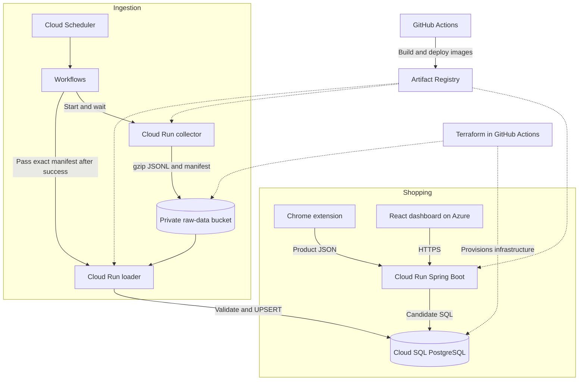

# SmartCart architecture and decisions

## Request and batch paths

**Data contract.** Raw objects are immutable and partitioned `raw/YYYY-MM-DD/RUN_ID/source.jsonl.gz`. The collector uploads the batch manifest **last** at `manifests/RUN_ID.json`. Workflows invokes the loader only after successful collection and passes the exact URI; no blind newest-file selection. Loader verifies SHA-256, counts and age, normalizes fields and performs PostgreSQL UPSERTs. Completed raw objects become eligible for GCS lifecycle deletion after **10 days** by default; lifecycle deletion is asynchronous. The normalized catalog persists independently.

**Runtime ownership.** Terraform owns IAM, Artifact Registry, Cloud SQL, GCS, Cloud Run service settings, Cloud Run Jobs, Workflows and Scheduler. GitHub Actions releases container images; Terraform ignores image changes to avoid rollback on reapply. GitHub OIDC/WIF supplies short-lived cloud identity; GCS holds remote Terraform state. Runtime service accounts have distinct permissions. API database enablement requires backend JDBC wiring.

## Architecture decision matrix

| Concern | Initial choice | Alternative / reason to revisit |
|---|---|---|
| API hosting | **Cloud Run**: request-driven stateless Spring Boot API | **GKE** if Kubernetes-specific scheduling, complex service mesh or multi-service control is justified; **Compute Engine** requires host operations |
| Batch execution | **Two Cloud Run Jobs** with separate identities/images | **GKE CronJobs/VMs** if long-running or specialized workers become necessary |
| Ordering | **Workflows** awaits collector, then invokes loader | **Eventarc** if files arrive independently; independent timers risk stale/incomplete loads |
| Scheduling | **Cloud Scheduler**; off until source access is verified | External cron/CI schedules are not our application scheduler |
| Raw evidence | **Cloud Storage JSONL gzip**, 10-day lifecycle | Direct-only PostgreSQL simplifies plumbing but loses exact source batch for replay; longer retention if policy and economics require |
| Query database | **Managed PostgreSQL 16 + JSONB** | **Firestore/Bigtable** for other access patterns; PostgreSQL suits relational identities, indexed lookup and transactions |
| Search | **PostgreSQL indexed identifiers + JSONB** | **Elasticsearch/OpenSearch** when measured fuzzy retrieval and query latency justify another synchronized index; not for 500 listings alone |
| Ingestion fan-out | **One bounded collector job** | **Pub/Sub/Cloud Tasks** when retailer-specific throughput, backpressure and retry isolation warrant distributed workers |
| Cache | **No cache initially** | **Memorystore/Redis** for measured repeated lookups; beware stale price/spec data |
| API contracts | **Versioned JSON** over HTTP | GraphQL only if multiple clients need substantially different shapes |
| Infrastructure | **Terraform + remote GCS state** | Console/gcloud for inspection/bootstrap only; Cloud Deployment Manager not selected |
| CI/CD | **GitHub Actions + OIDC**, automated releases on relevant reviewed main changes; controlled infrastructure applies | Cloud Build/Jenkins if stronger organizational controls or scale warrant |
| Secrets | **GCP Secret Manager** for API/database credentials | Avoid shared GitHub secrets for runtime credentials or committed key files |
| Images | **Artifact Registry** with commit-SHA tags | External registries add identity/network dependencies |
| Frontend | **Chrome extension + optional Azure-hosted dashboard** | GCP-only reduces cross-cloud complexity; Azure provides independent frontend hosting |
| Regionality | **Single US region initially** | Multi-region replication, backups and failover after availability targets justify cost/complexity |
| API exposure | **Private by default** during development | Public extension requires HTTPS, rate limiting, abuse controls, privacy notices and auth design |
| Data governance | **Permitted sources, immutable raw evidence and provenance** | Expand source set only after testing API rights, field quality and retention restrictions |

## Scaling checkpoints

| Stage | Data and operational focus |
|---|---|
| Initial POC | Offline parser tests plus first accepted live retailer offers; confirm batch and catalog contract |
| First real source | Permitted, model-seeded retailer HTML sources; assess model/spec/price completeness and access restrictions |
| Broader launch | 250–500 verified listings with meaningful cross-retailer overlap; manually label positive and hard-negative matching pairs |
| Growth | Measure load duration, source failures, API latency, DB query plans, connection pool utilization and cost before adding queues, cache, search index or GKE |

## Current implementation limits

Cloud resources are defined in Terraform and can be inspected through GCP and the deployment workflow. The Spring Boot service requires its own completed branch merge and database integration. The collection layer has HTTP/JSON-LD retailer adapters, but live site access and field completeness must be checked in each environment. Offline HTML tests are not live retail data. The system does not yet provide production authentication, abuse controls, multi-region availability or five authorized retailer data feeds. Cloud SQL has backups in dev but requires a tested recovery/retention strategy before production use.
