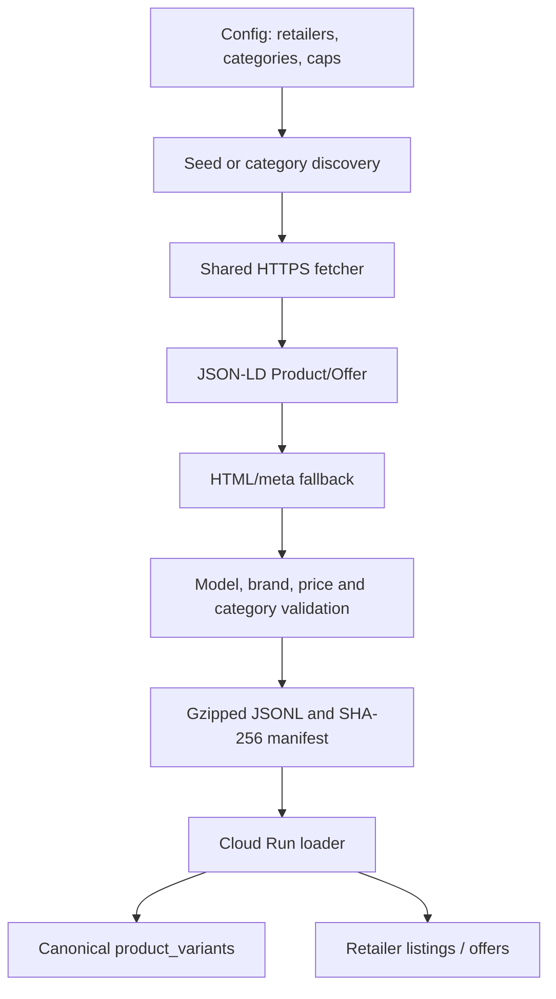

# Real-product collection

## Source strategy

The pilot supports televisions and dishwashers using small, auditable sources. The first three retailer adapters are `bestbuy`, `homedepot`, and `abt`. Their actual product-page URLs and expected manufacturer models live in `data/ingestion/config.yaml`. Seed model values are validation expectations; they are not silently substituted for missing HTML evidence.

Each retailer must have a permitted acquisition method before scheduled collection. A public website does not necessarily license automated harvesting, redistribution, or indefinite price retention. The fetcher honors robots exclusions, access denials and rate limits without using private endpoints, fingerprint spoofing or CAPTCHA bypasses. To move a source from experimental to recurring ingestion, confirm its terms and restrictions, then consider replacing the adapter with a licensed feed/API.

## Execution flow

`collector/scraping/adapters.py` defines domain allowlists, product URL rules, and retailer model/SKU HTML patterns. `extract.py` handles structured data, product variant validation, basic specifications and uncertain fields. `fetch.py` bounds payload size, timeouts and request cadence. `catalog.py` rotates sources and logs failures.

## Expanding coverage

1. Add verified product URLs under a retailer's `products` list. No Python change is needed to add more seeds.
2. To permit category discovery, set `DISCOVERY_MODE=category` and configure `category_urls` with a bounded `max_pages_per_category`.
3. Raise `MAX_RECORDS` and monitor accepted/failed counts and job duration. A setting of 500 is a ceiling, not a guarantee of 500 valid listings.
4. Add new retailers by defining an adapter and explicit allowed hosts, then register it in config.
5. Introduce feed/API transport later without changing record normalization or the GCS/Cloud SQL contract.

Real retail sites may render the product price dynamically or use complex content. Without structured product information, the correct response is a null price or rejected record, not a guessed MSRP. The fetcher doesn't implement browser emulation; add a separate optional rendering mode only for pages where it is permitted and needed.

## Extraction evidence

The key is manufacturer identity, not title similarity. `OLED55C6PUA` and `OLED65C6PUA` belong to the same TV family but are different screen sizes. `GDT650SYVFS` and `GDT650SMVES` differ in dishwasher finish. Retailer SKU and UPC may be different from manufacturer model; retain each separately. Seller/condition and availability influence price comparability.

Best Buy, Home Depot and Abt list the TV `OLED55C6PUA`. Best Buy and Home Depot also list the dishwasher `GDT650SYVFS`. Price discrepancies documented in external searches are illustrative of what the system must detect; the catalog never hardcodes those prices. Compare actual stored offer values and `collected_at` timestamps before displaying any saving.

## Quality checks

- Verify `collected_at`, `model`, `brand`, product URL and `source_type` on every accepted record.
- Look for variation of identical model across retailer offers; check mismatched variants as hard negatives.
- Treat stale offers as unverified. Query the `catalog.fresh_retailer_offers` view rather than returning all historic prices.
- Review `record_count`, `priced_records`, `attempted` and `failed` in each manifest and job logs. A record with no price supports identity matching but must not generate a savings claim.
- Review job failures in Cloud Run Logs and Workflow executions. Do not auto-enable Scheduler until repeated manual runs succeed.
- Observe the full cost of public Cloud SQL and Scheduler if enabled, even when ingestion has no paid API usage.
